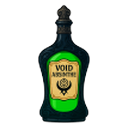

# 🐐 G.O.A.T.S.



**Gangriel's Otherworldly Alcohol Transport System**: a Bondage Club add-on for serving otherworldly drinks in chat
rooms.

**[Install G.O.A.T.S.](https://proudkiller0015.github.io/goats/install.html)**: a bookmark (no extension, phones too) or a
userscript. It always runs the newest version: the installed script only loads `goats.js` from this repo every time the
game opens.

## How it works

- Type `/goats` in a chat room. The tavern opens (with the goat).
- Pick a drink, pick who to serve, and press **🍷 Serve**, or **🥂 Drink myself**.
- The drink is a real crafted glass or bottle from the game, named after the drink. Everyone in the room sees it, with or
  without G.O.A.T.S. Only G.O.A.T.S. hands them out.
- If the person you served has G.O.A.T.S., they get a card: **🍷 Drink it** or **Not now**. The drink's effect only
  happens on their own screen, and only if they choose to drink.
- Serving follows the game's rules: someone who doesn't allow you to use items on them can't be served, and full hands
  can't take a glass.

## The drinks

| Drink                    | What it does to the drinker                                         |
| ------------------------ | ------------------------------------------------------------------- |
| Void Absinthe            | Reality slips away for a moment (V O I D)                           |
| Rosé Cœur                | Hearts, a pink glow, and LSCG's horny state if you have LSCG        |
| Moonwalker Vodka         | Feels like walking on the moon ★ ☽ ★                                |
| Firebite Cinnamon Whisky | Your throat's on fire, and so is the chat                           |
| Aphasia                  | Garbled speech for about a minute (needs LSCG)                      |
| Abaddon                  | Out cold: LSCG's asleep state for 30 minutes (needs LSCG)           |

G.O.A.T.S. is built to break before the game does: everything runs inside a guard, so if the game changes, it shows a
note in its menu and the game carries on.

## Credits

G.O.A.T.S. is Gangriel's. The drinks, their pictures and sounds come from the original G.O.A.T.S.
([gitlab.com/kitco2/goats](https://gitlab.com/kitco2/goats)). This version was rebuilt by SlimeQueenSamantha.

## Checks

```sh
node --check goats.js
node test.js    # the real game, headless and never logged in: menu, serving, the drink card, effects
```

`test.js` expects Chrome and puppeteer-core at the paths at its top, and a local Bondage Club checkout (`ROOT`).
